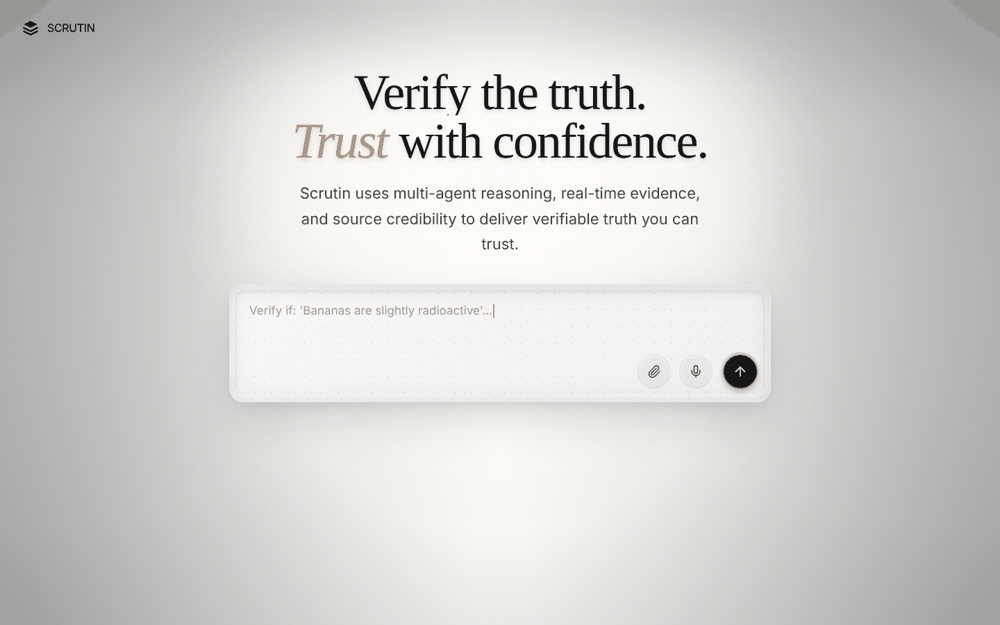
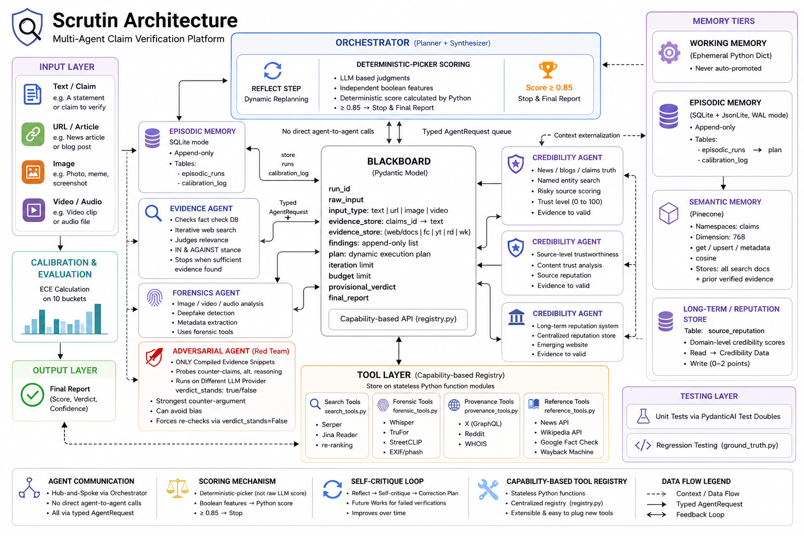

# Scrutin

Scrutin verifies claims. You give it a sentence or an article URL, six AI agents investigate it, and it returns a verdict (true, false, misleading, unverifiable or inconclusive) with a credibility score and the evidence behind it.

[](https://www.python.org/)
[](https://fastapi.tiangolo.com/)
[](https://react.dev/)
[](https://ai.pydantic.dev/)
[](LICENSE)



## Overview

Checking a claim does not take a fixed number of steps. A statement from a reliable outlet may be settled by a single fact-check API lookup. A video with a misleading caption may need transcript extraction, reverse image search and several rounds of re-checking before a verdict is safe. A plain RAG pipeline runs the same retrieval steps either way.

Scrutin uses a hub-and-spoke design instead. Six agents each have a narrow job and a list of things they may not do. An Orchestrator coordinates them through a shared Blackboard, an append-only state object for each run that every agent reads from and writes to.

A few choices shape how it behaves:

- The Orchestrator replans based on what evidence is still missing, so easy claims finish quickly and hard ones get more iterations.
- An Adversarial Verifier tries to break each provisional verdict before it is published. It runs on a different model provider from the evidence agent.
- Confidence scores come from Python. Each agent answers yes/no questions and the code combines the answers into the score (the deterministic-picker pattern). No raw LLM float is used.
- Every agent's reasoning, each piece of evidence and each adversarial critique stays in the final report and the episodic log.

## Quick start

```bash
git clone https://github.com/RohitDSonawane/Scrutin.git
cd Scrutin/backend
python -m venv .venv && source .venv/bin/activate   # Windows: .venv\Scripts\activate
pip install -r requirements.txt
cp .env.example .env                                  # add GOOGLE_API_KEY, GROQ_API_KEY, SERPER_API_KEY, PINECONE_API_KEY
python -m app.memory.migrations
python -m app.cli verify --claim "The Eiffel Tower was completed in 1889"
```

You need Python 3.11 or 3.12. For the web UI and the full configuration, see [SETUP.md](./SETUP.md).

## The six agents

| # | Agent | Model | Job | Must not |
|---|-------|-------|-----|----------|
| 1 | Orchestrator (planner and synthesizer) | `gemini-2.5-flash` | Holds global state, plans execution, delegates, resolves conflicts and writes the final verdict | Fabricate evidence, skip the adversarial step, or call sub-agents directly (it must go through the Plan) |
| 2 | Claim Decomposition and Framing | `groq:llama-3.1-8b-instant` | Turns raw input into atomic, checkable claims and separates fact from opinion and framing | Judge truth or falsity, use tools, or invent claims that are not in the source text |
| 3 | Evidence and Corroboration | `gemini-2.5-flash` | Runs iterative search, judges relevance and flags evidence gaps | Set the final credibility score, judge source trustworthiness, or do forensic media analysis |
| 4 | Source and Provenance Credibility | `groq:llama-3.3-70b-versatile` | Judges how trustworthy the originating source is (track record, ownership, domain age) | Judge whether the claim's content is true, run new web searches, or write reputation updates directly |
| 5 | Multimodal Forensics | `gemini-2.5-flash` | Judges whether media is manipulated, authentic but miscaptioned, or authentic but misleading | Judge whether the caption is true, or force a real/fake call on mixed signals |
| 6 | Adversarial Verifier (red team) | `groq:llama-3.3-70b-versatile` | Attacks the provisional verdict with the strongest good-faith counter-argument | Run general new searches, inherit the Evidence agent's reasoning trace, or set the final verdict |

The full system prompts and output schemas are in [docs/agent-system-prompts.md](./docs/agent-system-prompts.md).

The Adversarial Verifier gets only the raw compiled evidence and the provisional verdict string. It never sees the Evidence agent's reasoning or planning notes, and it runs on Groq/Llama instead of Gemini so the two sides do not share the same training biases. This isolation is a hard rule of the project (see [AGENTS.md](./backend/.agents/AGENTS.md), section 6).

## Architecture



Agents never call each other. Cross-agent requests are typed `AgentRequest` objects placed on the Blackboard, and the Orchestrator handles them on its next loop iteration.

```text
┌─────────────────────────────┐     HTTP POST /api/verify     ┌───────────────────────────────┐
│   React 19 + Vite Frontend  │ ───────────────────────────▶ │    Python FastAPI Backend      │
│   (port 5173 in dev)        │                               │    (port 8000)                 │
│                              │ ◀─── VerificationReport ───── │                                │
│  · Hero input                │                               │   ┌─────────────────────────┐  │
│  · SpatialScroll panels      │                               │   │      Orchestrator       │  │
│  · Verification workspace    │                               │   │   (Plan + Blackboard)   │  │
└─────────────────────────────┘                               │   └───────────┬─────────────┘  │
                                                                │               │ Tasks           │
                                                                │   ┌───────────┴─────────────┐  │
                                                                │   │  Decomposition  Evidence │  │
                                                                │   │  Credibility    Forensics│  │
                                                                │   │       Adversarial        │  │
                                                                │   └──────────────────────────┘  │
                                                                │        ▲ appends Findings        │
                                                                │        │ (never overwrites)       │
                                                                │   ┌────┴─────────────────────┐   │
                                                                │   │  Blackboard (Pydantic)   │   │
                                                                │   │  evidence_store / findings│  │
                                                                │   └──────────────────────────┘   │
                                                                └────────────────────────────────┘
```

The project follows these rules (the full list is in [AGENTS.md](./backend/.agents/AGENTS.md)):

- No LangGraph or other graph runtime. The orchestration loop is a plain `while` loop in `orchestrator/loop.py`.
- Every agent output is a validated Pydantic `BaseModel`, so no raw dicts cross agent boundaries.
- Each run ends with a Reflexion-style self-critique. The LLM commits to booleans and Python composes the pass/fail signal.
- Large content such as scraped HTML and transcripts lives on the Blackboard under an ID (`WB1`, `TR3` and so on). Agents pass IDs around, not the content.
- Independent tool and agent calls run together with `asyncio.gather()`.

[ARCHITECTURE.md](./ARCHITECTURE.md) covers the Blackboard schema, the scoring formula, the self-critique loop, the database tables and the tool registry. [SETUP.md](./SETUP.md) covers running it locally.

## API

### `POST /api/verify`

Runs a full verification on a claim or URL.

Request:
```json
{
  "claim": "The Eiffel Tower was built in 1889"
}
```

Response (`VerificationReport`):
```json
{
  "run_id": "a1b2c3",
  "overall_verdict": "true",
  "credibility_score": 85.0,
  "confidence": 0.92,
  "iterations_used": 3,
  "processing_time_seconds": 5.4,
  "evidence_used": [...],
  "adversarial_summary": "...",
  "budget_exhausted": false
}
```

`overall_verdict` is one of `true`, `false`, `misleading`, `unverifiable` or `inconclusive`. `credibility_score` runs from 0 (false) to 100 (true). `confidence` is the Orchestrator's calibrated 0.0 to 1.0 confidence in that score, taken from the deterministic-picker evaluation.

Interactive docs are at `http://localhost:8000/api/docs` and the health check is at `http://localhost:8000/api/healthz`.

## Command line

The backend runs without the frontend:

```bash
python -m app.cli verify --claim "The COVID-19 vaccines caused 50,000 deaths in the US"
python -m app.cli verify --url "https://example.com/article"
python -m app.cli verify --claim "..." --trace   # verbose Blackboard trace
python -m app.cli test                            # ground-truth regression suite
python -m app.cli stats                           # calibration report (ECE)
```

Each step prints a color-coded trace line through `loguru`. An example is in [ARCHITECTURE.md](./ARCHITECTURE.md#terminal-trace-example).

## Roadmap

Everything here is planned, not built.

SDKs and API access: Python and Node/TypeScript SDKs, managed API keys that route claims to hosted infrastructure, and programmatic access to `credibility_score`, `confidence` and the raw adversarial critique for teams building trust and safety pipelines.

Near-term technical work:

- Calibration loop. `calibration_log` records stated confidence against the actual outcome for each run. The next step is to feed Expected Calibration Error (ECE) back into prompt and threshold tuning automatically. For now it is reviewed by hand with `python -m app.cli stats`.
- Source reputation cache. `source_reputation` is SQLite-only in the MVP. Once there is enough WHOIS and track-record data, it should become a write-through cache in front of live lookups.
- Media hashing in Pinecone. Perceptual hashes (`imagehash.phash`) are stored as raw hex in SQLite because the free Pinecone tier allows one index, and `claims` already uses it at `dimension=768`. With a second index, the `media` namespace can move to `dimension=64, metric="hamming"`. The migration note is in [docs/database-schema.md](./docs/database-schema.md).
- Reflexion memory reuse. `AgentReflection` entries are written on `insufficient_evidence` or retried runs but the Orchestrator does not read them at plan time yet. The next step is to check past reflections for similar claims before planning.
- More tools. `provenance_tools.py` covers WHOIS, X (through cookie-based `bird_x.py`) and Reddit. Instagram, LinkedIn and TikTok scrapers are left out because they are too flaky for reliable verdicts, and so are the paid X/Grok API tiers. The reasoning is in [docs/tool-integration-spec.md](./docs/tool-integration-spec.md).

Out of scope for now: a local Wikipedia FAISS index (`wiki_dump.py`, since the hosted Wikipedia API is enough for the MVP), any graph-DSL orchestration runtime (studied for ideas, never imported; see [AGENTS.md](./backend/.agents/AGENTS.md), section 1), and the older `reddit.py` client, which the PRAW-based one replaced.

If you are returning to the project after a break, read [AGENTS.md](./backend/.agents/AGENTS.md) first, then [ARCHITECTURE.md](./ARCHITECTURE.md), then [SETUP.md](./SETUP.md).

## License

MIT. See [LICENSE](./LICENSE).
